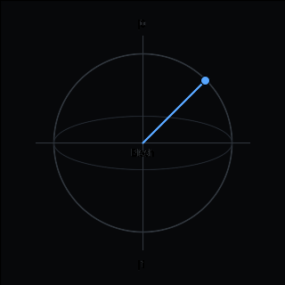
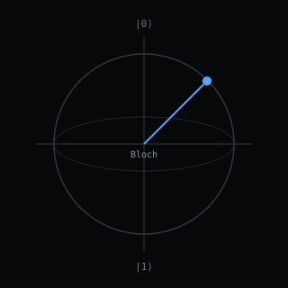
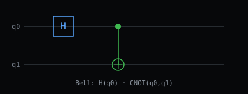
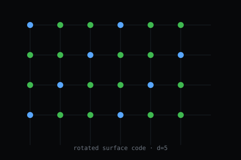
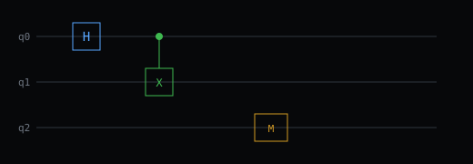
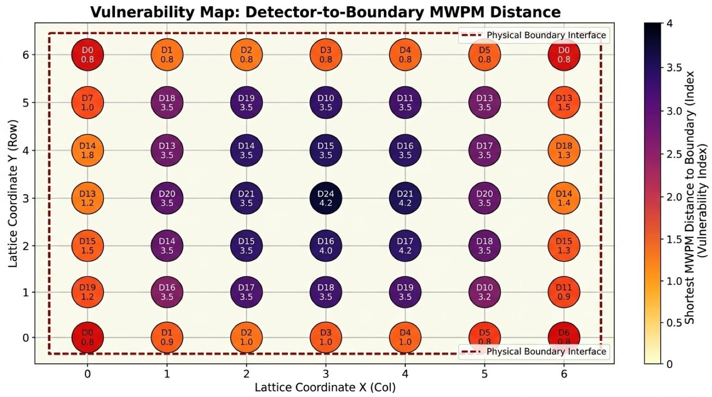
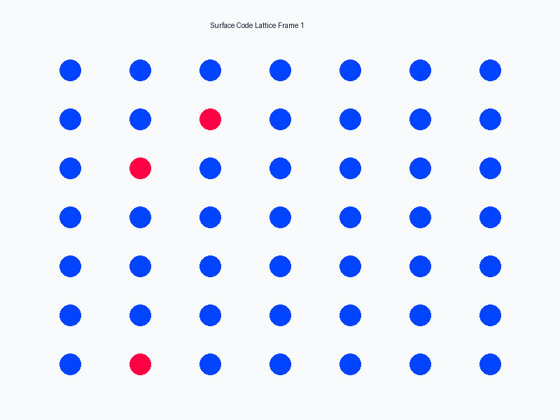

# Surface Code Boundary Lab

[](https://ahmadaliparr.github.io/surface-code-boundary-lab/)
[](LICENSE)

**Atlas:** [ahmadaliparr.github.io/surface-code-boundary-lab/docs/library.html](https://ahmadaliparr.github.io/surface-code-boundary-lab/)



## Live

| | |
|---|---|
| [Quantum Lens](https://ahmadaliparr.github.io/surface-code-boundary-lab/quantum_lens.html) | QPU control, bifurcation swarm |
| [Voyager Maze](https://ahmadaliparr.github.io/surface-code-boundary-lab/maze.html) | Spine 64 nodes, mock key |
| [Z408](https://ahmadaliparr.github.io/surface-code-boundary-lab/z408.html) | Homophonic, reverse, mirror |
| [Cipher Bench](https://ahmadaliparr.github.io/surface-code-boundary-lab/cipher.html) | Z408 / Z340 paths |

## Diagrams

| Bloch | Bell | Lattice | Circuit |
|---|---|---|---|
|  |  |  |  |

## Maps





## Code

| Path | Role |
|---|---|
| `src/cudaq` `src/qsharp` `src/quipper` | Circuit backends |
| `src/rust` `src/cpp` `src/c` `src/fortran90` `src/forth` | Simulators |
| `src/mlir` | MLIR + ANU QRNG |
| `src/sim` | Statevector simulator, cipher oracles |
| `src/cipher` | Z408, Z340, MixColumns, maze block cipher |
| `src/maze` | Voyager, Many-Worlds, QSL, bifurcation |
| `scripts` | Stim factory, boundary analysis |
| `docs/multiplicity` | 64-layer spine, hex cipher |

## Run

```sh
make install && make test-python
PYTHONPATH=src python3 src/sim/qsim.py
```

## Docs

[Atlas](docs/ATLAS.md) · [Spine](docs/multiplicity/64_layer_premidoral_spine.md) · [Hex cipher](docs/multiplicity/spine64_hex_cipher.md) · [Analysis](docs/ANALYSIS_CONTRACT.md)

AGPL-3.0-or-later · SnapKitty Collective / Bel esprit D'accord Trust
