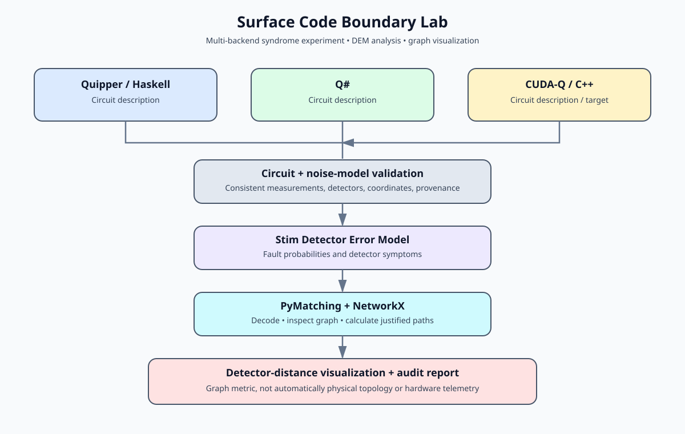

# Surface Code Boundary Lab


Production repository for multi-backend surface-code stabilizer extraction, boundary-distance analysis, MLIR-driven entropy injection, and the 64-layer Premidoral multiplicity functor spine.

Copyright (C) 2026 SnapKitty Collective / Bel esprit D'accord Trust.  
Licensed under the GNU Affero General Public License v3 or later. See [LICENSE](LICENSE).

## Overview

A finite surface code protects logical information by topology, but the topology has edges. The vulnerability index used here is the shortest path on the decoder matching graph from a detector to the nearest boundary node. Short distances (warm colors in the map below) indicate higher vulnerability; longer distances indicate greater protection.


The pipeline connects independent circuit backends to a common Stim analysis path and a live visualization:



## Repository Layout

| Path | Contents |
|------|----------|
| `src/cudaq/` | CUDA-Q C++ kernels: Z/X bulk and boundary stabilizers, multi-round memory, fault injection, surface utilities |
| `src/qsharp/` | Q# stabilizer operations, logical operators, multi-round history, utilities |
| `src/quipper/` | Quipper/Haskell circuit descriptions with bulk/boundary faces and logical operators |
| `src/rust/` | Rust classical simulator with unit tests, boundary-distance map, depolarizing noise |
| `src/cpp/` | Standalone C++ simulator |
| `src/c/` | Standalone C simulator |
| `src/fortran90/` | Fortran 90 simulator |
| `src/forth/` | Forth simulator |
| `src/mlir/` | MLIR dialect sketch + Python interpreter; ANU QRNG vacuum-fluctuation entropy injection with multiplicity mixing and system-RNG fallback |
| `scripts/` | Stim surface-code factory, DEM extraction, PyMatching boundary-distance analysis, WebSocket telemetry server, analysis utilities |
| `frontend/` | React Three Fiber lattice visualization (instanced mesh, WebSocket telemetry) |
| `circuits/` | Example Stim circuits |
| `docs/` | Analysis contract, validation checklist |
| `docs/multiplicity/` | 64-layer Premidoral functor spine (Lemmas 1–64) and Spine 64 Hex Cipher (Shadow Prime Continuum) |
| `visuals/` | Vulnerability map, lattice animation, pipeline diagram |
| `.github/workflows/` | CI: Python path + native C/C++/Fortran builds |

## Quick Start

```sh
# Python analysis
make install
make test-python

# Native backends
make build-cpp
make build-c
make build-fortran
make build-rust

# MLIR interpreter (ANU QRNG with fallback)
make run-mlir

# Frontend
cd frontend && npm install && npm run dev
```

Individual backend entry points:

```sh
# C++
g++ -O2 -o surface_code_cpp src/cpp/surface_code.cpp && ./surface_code_cpp

# C
gcc -O2 -o surface_code_c src/c/surface_code.c && ./surface_code_c

# Fortran 90
gfortran -O2 -o surface_code_f90 src/fortran90/surface_code.f90 && ./surface_code_f90

# Rust
cd src/rust && cargo run && cargo test

# Forth
gforth src/forth/surface_code.fs

# MLIR
python src/mlir/run_mlir_backend.py
```

## Analysis Path

1. `scripts/generate_surface_code.py` — Stim rotated surface-code factory.
2. `scripts/analyze_boundary_vulnerability.py` — extracts the detector error model, builds the PyMatching graph, computes shortest-path distances to boundary nodes.
3. `scripts/mwpm_telemetry_server.py` — WebSocket server streaming defect coordinates to the frontend.
4. `frontend/src/QuantumLattice.jsx` — Three.js instanced-mesh lattice with live defect coloring.

See `docs/ANALYSIS_CONTRACT.md` for the input/output contract and `docs/VALIDATION.md` for the reproducibility checklist.

## MLIR Backend and Entropy Injection

`src/mlir/SurfaceCode.mlir` sketches a surface-code dialect (`alloc_data`, `apply_x`, `inject_entropy`, `syndrome_round`, `logical_z`).  
`src/mlir/run_mlir_backend.py` interprets these operations and injects entropy drawn from the ANU Quantum Random Number Generator (vacuum fluctuations):

- Endpoint: `https://qrng.anu.edu.au/API/jsonI.php`
- Multiplicity mixing: independent batches are XORed before use.
- Fallback: system RNG when the legacy endpoint is rate-limited.

## Multiplicity Documentation

- [`docs/multiplicity/64_layer_premidoral_spine.md`](docs/multiplicity/64_layer_premidoral_spine.md) — Lemmas 1–32 (categorical, topological, quantum, QMHES foundations) and Lemmas 33–64 (64-layer Premidoral spine under the Bel esprit D'accord Trust).
- [`docs/multiplicity/spine64_hex_cipher.md`](docs/multiplicity/spine64_hex_cipher.md) — Shadow Prime Continuum, hexadecimal cipher matrix for the first 64 Riemann-zero shadows, and decryption protocol.

## Continuous Integration

`.github/workflows/ci.yml` runs on push and pull request to `main`:

- Python 3.11: install dependencies, generate Stim circuit, run MLIR interpreter.
- Native: compile and execute the C, C++, and Fortran 90 backends.

## License

GNU Affero General Public License v3 or later.  
All source files carry SPDX license identifiers.
